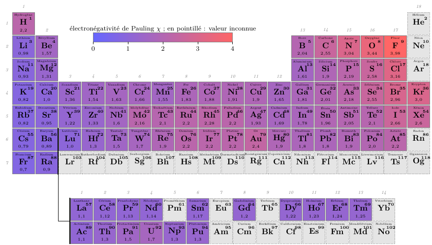
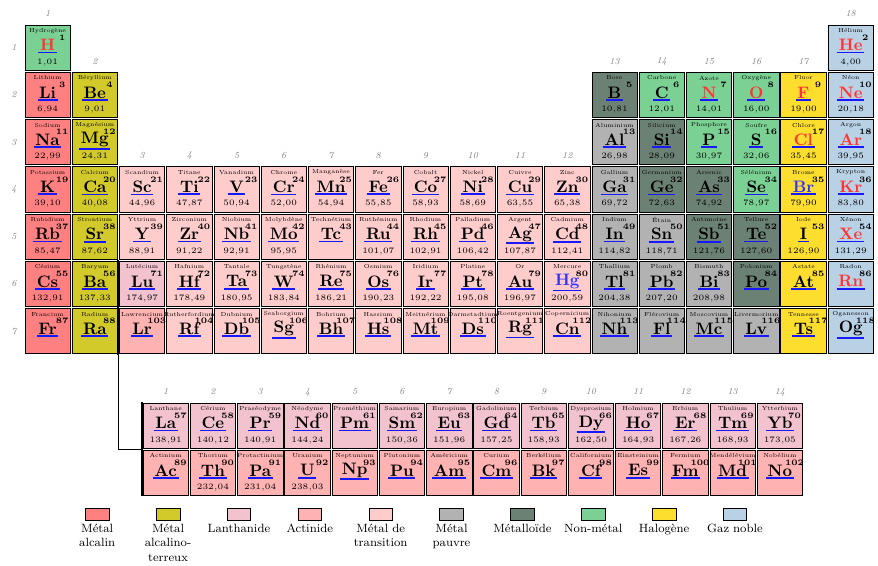

# pychimie

Thermochimie (avancement, équilibre, rupture), données atomiques et tableau périodique en TikZ

Les équilibres en solution (pH, titrages pH-métriques, conductimétriques et
potentiométriques) relèvent du paquet [titrages](https://github.com/antnardo/titrages).

## Installation

Python 3.11 ou plus, numpy et scipy ; rien d'autre (CoolProp, pint, mendeleev ne
sont pas des dépendances : la table des éléments est figée dans le paquet).

```bash
pip install git+https://github.com/antnardo/pychimie
```

Ou, pour travailler sur le code, `git clone` puis `uv sync --group dev` dans le
dossier ; `uv run pytest` lance les tests. Pour les gabarits TikZ, un TeX Live avec
LuaLaTeX, siunitx et hyperref.

## Équilibres chimiques

Le module de thermochimie suit le cours de CPGE : une réaction, son K°(T), et un système
qui évolue par cette réaction, de l'état initial à l'état final — équilibre ou rupture
d'équilibre.

```python
from pychimie import Reaction, Systeme, perturber

nh3 = Reaction("N2(g) + 3 H2(g) = 2 NH3(g)", DrH0=-92.2e3, DrS0=-198.8)  # J/mol, J/K/mol
s = Systeme(nh3, {"N2": 1, "H2": 3}, T=700, P=200)  # mol, K, bar
s.xi_eq()  # 0.5774 mol
xi = s.avancements()  # ξ entre ξ_min et ξ_max, bornes exclues
s.Q(xi), s.DrG(xi), s.G(xi)
perturber(s, P=300).sens  # +1 : une hausse de P déplace vers NH₃
```

### Réaction et K°(T)

- `Reaction(équation, DrH0=…, DrS0=…)` : les valeurs d'un énoncé. Elles sont
  obligatoires.
- `Reaction.depuis_tables(équation)` : ΔrH° et ΔrS° par la loi de Hess, à partir de la
  table de `src/pychimie/donnees/` ; `kirchhoff=True` garde ΔrC°p.
- `Reaction.depuis_K0(équation, K0, T=…, DrH0=…)` : K° à une température, et la loi de
  van 't Hoff si ΔrH° est donné ; sans ΔrH°, K° ne dépend pas de T.
- `r.K0(T)`, `r.ln_K0(T)`, `r.DrG0(T)`, `r.DrH0(T)`, `r.DrS0(T)` acceptent des tableaux.
  L'approximation d'Ellingham est le cas ΔrC°p = 0 (`r.ellingham()`).
- `r.temperature(K0)` : l'inverse de `K0(T)` — la température où K° vaut `K0`, et
  sans argument la température d'inversion (K° = 1).
- `r.donnees_de("NH3")` : l'inverse de `depuis_tables` — ΔfH°, S°m (et C°p) d'une
  espèce déduits de ΔrH°, ΔrS° d'un énoncé et des tables pour les autres ; la table
  s'en augmente (`table_thermo().avec(d)`) et s'écrit (`TableThermo.ecrire`).

L'équation s'écrit avec la phase de chaque constituant : `g`, `l`, `s` ou `aq`. Un `s`
ou un `l` sans étiquette est un corps pur (activité 1) ; `l1`, `s2`… désignent un
mélange idéal (activité égale à la fraction molaire). Le solvant est un constituant
comme un autre : donner sa quantité (55,5 mol pour un litre d'eau).

### Système, état final, rupture

Unités : quantités en mol, `T` en K, `P` en bar (P° = 1 bar), volumes en L
(c° = 1 mol/L). Une pression au-delà de 10⁴ bar ou une température au-dessous de
100 K est refusée, avec la conversion dans le message : `P=200e5` (des pascals) et
`T=25` (des degrés Celsius) ne passent pas en silence.

`Systeme(reaction, initial, T=…, P=…, V=…, V_gaz=…, inertes=…)` : `P` est la pression
imposée (bar), `V` le volume de la solution (L) quand il y a des solutés, `V_gaz` le
volume du gaz s'il est fixé à la place de P, `inertes` les constituants inactifs
(`{"Ar(g)": 1}`).

- `K0()`, `DrG0()` : K° et ΔrG° à la température du système ; `K0(T)`, `DrG0(T)` à
  une autre, comme `Reaction.K0(T)`.
- `xi_min`, `xi_max`, `avancements()`, `n(nom, ξ)`, `activite(nom, ξ)`, `Q(ξ)`,
  `DrG(ξ)`, `G(ξ)` (à une constante près : G(0) = 0), `minimum_G()`.
- `etat_final()` : avancement, quantités, fractions molaires, Q et K°, et, en cas de
  rupture d'équilibre, les constituants disparus. `xi_eq()` lève `RuptureEquilibre`
  quand l'état final n'est pas un équilibre.
- `avec(T=…, P=…, initial=…)` : le même système dans d'autres conditions.

### Déplacements d'équilibre

- `perturber(s, T=…)`, `perturber(s, P=…)`, `perturber(s, ajout={"Ar(g)": 1})` :
  l'équilibre de départ, Q et K° juste après la perturbation, le sens d'évolution et le
  déplacement δξ.
- `balayage(s, T=valeurs)`, `balayage(s, P=…)`, `balayage(s, ajout={"Ar(g)": …})` :
  ξ_f, taux d'avancement, quantités et fractions finales le long du même paramètre
  que `perturber` — ici la quantité s'ajoute à la composition initiale ; et
  `balayage(lambda x: s.avec(initial={"N2": x, "H2": 1 - x}), x)` pour tout autre
  paramètre.

Les scripts de `exemples/equilibres/` refont ceux du cours (`Optimisation_NH3_*.py`,
`Optimisation_Boudouard.py`) et y ajoutent K°(T) avec Kirchhoff, les déplacements
d'équilibre, la rupture d'équilibre du carbonate de calcium, et
`nh3_ellingham_kirchhoff_nasa.py`, qui compare K°(T) de la synthèse de l'ammoniac en
approximation d'Ellingham, avec Kirchhoff et par les polynômes NASA de GRI-Mech 3.0
(coefficients recopiés, sans Cantera) : à 700 K, 3,2·10⁻⁴, 6,9·10⁻⁵ et 8,8·10⁻⁵.

### Données

`src/pychimie/donnees/thermo298.csv` donne ΔfH°, S°m et C°p à 298,15 K pour 127
espèces : gaz simples et composés de l'azote, du soufre et du phosphore (NH₃, NO,
NO₂, N₂O₄, SO₂, SO₃, H₂S, H₂SO₄, HNO₃, PCl₃, PCl₅, NH₄Cl, urée…), halogènes et
hydracides, le carbone et ses composés jusqu'à C₂ (CO, CO₂, CH₄, C₂H₂, C₂H₄, C₂H₆,
méthanol, éthanol, éthanal, acide éthanoïque), les métaux usuels avec leurs oxydes,
sulfures et sels (Na, K, Mg, Ca, Al, Si, Ti, Cr, Mn, Fe, Ni, Cu, Zn, Ag, Sn, Pb, Hg),
et 28 espèces en solution aqueuse (H⁺ par convention, OH⁻, Na⁺, Cl⁻, SO₄²⁻, Fe²⁺,
Fe³⁺, MnO₄⁻, CH₃COO⁻…) à l'état standard c° = 1 mol/L. Les valeurs viennent des tables
NBS (Wagman et al., 1982) et, pour FeO, des tables NIST-JANAF (Chase, 1998) ; la
plupart des ions n'ont pas de C°p dans ces tables (`Cp0` vaut `None`, et
`depuis_tables(kirchhoff=True)` le dit). `src/pychimie/donnees/SOURCES.md` donne les
références, les conventions, ce qui a été écarté faute de valeur sûre, et la licence.
Le fichier est écrit par `scripts/ecrire_donnees_thermo.py`.

## Éléments, formules et tableau périodique

### Les 118 éléments

`element()` rend un élément par son numéro atomique, son symbole ou son nom français
(sans tenir compte de la casse ni des accents) ; `tableau_periodique()` rend la table
entière, que l'on filtre ou dont on extrait une colonne.

```python
from pychimie import element, tableau_periodique

fer = element("fer")  # ou element(26), element("Fe")
fer.masse_molaire  # 55.845 (g/mol, CIAAW)
fer.theta_fusion  # 1538.0 (°C) ; fer.T_fusion en K
fer.famille, fer.configuration  # 'métal de transition', '[Ar] 3d6 4s2'

t = tableau_periodique()
[e.symbole for e in t.filtrer(famille="halogène")]
t.valeurs("electronegativite")  # {'H': 2.2, 'He': None, …}
```

Une grandeur a une seule unité (g/mol, pm, eV, K, kg/m³) et vaut `None` quand elle
est inconnue. La table est figée dans `src/pychimie/donnees/elements.csv` ; ses
sources et leurs licences — masses de la CIAAW, propriétés du paquet mendeleev
(MIT), aucune donnée de Wikipédia — sont détaillées dans
`src/pychimie/donnees/SOURCES.md`.

### Formules brutes et préparation de solutions

```python
from pychimie import Formule, Preparation, masse_a_peser, masse_molaire

masse_molaire("CuSO4·5H2O")  # 249.68 g/mol
Formule.lire("K4[Fe(CN)6]").hill  # 'C6FeK4N6'
Formule.lire("SO₄²⁻").charge  # -2
Formule.lire("Cu^2+(aq)").phase  # 'aq'
masse_a_peser("CuSO4·5H2O", 0.10, 0.1)  # 2.50 g pour 100 mL à 0,10 mol/L
Preparation.commerciale("H2SO4", 0.96, 1.84).concentration  # 18.0 mol/L
```

Les hydrates (`·`, `.`, `*` ou la virgule française : `CuSO4, 5 H2O`), les parenthèses et crochets imbriqués, les indices et
exposants Unicode sont lus ; une charge s'écrit `^2-`, `²⁻` ou, pour ±1, d'un signe
seul (`NH4+`) ; une phase finale `(s)`, `(l)`, `(g)` ou `(aq)` est gardée à part
(`Formule.phase`). `Preparation` (masse à peser, volume à prélever, solution du
commerce) n'est pas la `Solution` de `titrages`, qui décrit une solution par ses
couples acide-base : les équilibres en solution (pH, titrages) relèvent de ce paquet.

### Tableau périodique en TikZ





Ces deux tableaux sortent des gabarits `Tableau_ombrage_chi.tex` et
`Tableau_simple_metaux.tex` de `exemples/periodikz/`, compilés par LuaLaTeX sur ce que
`TableauTikz` écrit (`ombrage_chi.py`, `simple_metaux.py`).

`TableauTikz` produit, élément par élément, les commandes qu'un gabarit TikZ met en
forme. Chaque méthode ajoute une couche pour les 118 éléments, dans l'ordre d'appel :

- `cases("famille")` : une case par élément, stylée par la valeur d'un attribut
  qualitatif (`\dessinecase[famille=halogène]{17-2}`) ;
- `ombrage("electronegativite", "chi")` : une case par élément, ombrée selon une
  propriété numérique ramenée à un entier de 0 à 100 et passée en argument d'un style
  (`\dessinecase[chi=73]{17-2}`) ; `bornes=(0, 4)` fixe l'échelle, `defaut="sans chi"`
  habille les éléments sans valeur ;
- `symboles("etat")` : le symbole, en hyperlien vers Wikipédia FR si `liens=True`,
  stylé comme une case ;
- `infos(attribut, style, format)` : une information par case, avec un modèle
  (`r"\num{{{}}}"`) ou une fonction de la valeur ;
- `legende("famille", …)` : une entrée `\legend` ou `\legendhoriz` par valeur.

```python
from pychimie import FAMILLES, TableauTikz

t = TableauTikz(liens=True).cases("famille").symboles("etat")
t.infos("masse_molaire", "M info", r"\num{{{}}}").infos("nom", "nom").infos("Z", "Z")
t.legende("famille", ligne=1, horizontale=True, valeurs=FAMILLES)
t.ecrire("simple_metaux.tex")

ombre = TableauTikz(liens=False).ombrage("electronegativite", "chi", bornes=(0, 4), defaut="sans chi")
ombre.symboles().infos("electronegativite", "chi info", r"\num{{{}}}").ecrire("ombrage_chi.tex")
```

Le gabarit définit les coordonnées (`<groupe>-<période>`, `<rang>-L` et `<rang>-A`
pour le bloc f), la commande `\dessinecase`, les styles, et pour les légendes
`\legend` et `\legendhoriz`. Un attribut qualitatif se style par un choix, un ombrage
par un **style à argument**, où `#1` est la valeur de 0 à 100 :

```latex
\begin{tikzpicture}[
  famille/.is choice,
  famille/halogène/.style={fill=yellow!80!white!90!red},
  chi/.style={fill=red!#1!blue!60!white},   % \dessinecase[chi=73]{17-2}
  sans chi/.style={fill=black!10, densely dotted},
]
\input{ombrage_chi}
\end{tikzpicture}
```

Deux gabarits complets sont dans `exemples/periodikz/` : `Tableau_simple_metaux.tex`
(familles, états, masses, légende horizontale ; produit par `simple_metaux.py`) et
`Tableau_ombrage_chi.tex` (électronégativité en dégradé avec sa barre d'échelle ;
produit par `ombrage_chi.py`). Pour le paquet LaTeX pgf-PeriodicTable, qui dessine
lui-même symboles et informations, `schema_categories` et `schema_degrade` sont les
pendants de `cases` et `ombrage` : ils écrivent un `\pgfPTnewColorScheme` (exemple :
`pgf_electronegativite.py` et `Tableau_pgf_electronegativite.tex`).

### Régénérer la table

```bash
uv run python scripts/telecharger_ciaaw.py
uv run --group donnees python scripts/generer_elements.py
```

## Pour plus tard

Un `Systeme` évolue par **une seule** réaction. Les sujets qui couplent plusieurs
équilibres — la réduction de FeO par CO en présence de l'équilibre de Boudouard
(deux constantes à 1000 K, un volume fixé, les volumes critiques où un solide
disparaît) — demandent un vecteur d'avancements
(ξ₁, …, ξₖ) : les quantités deviennent nᵢ = nᵢ,₀ + Σⱼ νᵢⱼ ξⱼ, l'état final est le
minimum de G(ξ₁, …, ξₖ) sur le polytope où toutes les quantités restent positives, et
une rupture d'équilibre est l'arrivée sur une face de ce polytope. L'extension
naturelle est une classe `Systeme` à plusieurs `Reaction` partageant les mêmes
constituants, avec le même `etat_final()` (minimisation convexe sous contraintes, à la
place de la dichotomie sur ξ) et les mêmes `perturber`/`balayage` ; `TC-E08.py` en
est le cas d'usage à reproduire. Rien n'est commencé.

## Licence

Le code — le paquet (`src/`), les tests et les scripts — est sous licence MIT
(`LICENSE`). Les exemples (`exemples/`), qui sont du contenu scientifique et
pédagogique plutôt que des algorithmes, sont sous licence Creative Commons
Attribution - Pas d'utilisation commerciale - Partage dans les mêmes conditions 4.0
International, CC BY-NC-SA 4.0 (`LICENSE-CC-BY-NC-SA-4.0`).
